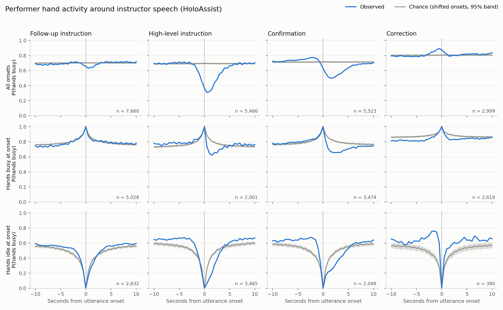

# HoloAssist pilot part 3: the hands around an instructor utterance

Generated by `python -m scripts.holoassist_aftermath`. 1568 videos, null = per-video circular shift, 500 repetitions. Idle seconds = time with no annotated hand action, summed over the 5 s window. Excess = observed minus the null mean. See the script docstring for the two readings.

Median utterance length (s): {'follow_up': 2.7, 'high_level': 2.66, 'confirm': 0.75, 'correct': 3.04}

## all

| group | onsets | idle s in 5 s BEFORE: observed / null / excess (p) | idle s in 5 s AFTER: observed / null / excess (p) | after minus before: excess (p) |
|---|---|---|---|---|
| follow_up | 7660 | 1.518 / 1.497 / +0.021 (0.20359) | 1.585 / 1.495 / +0.090 (0.002) | +0.069 (0.002) |
| high_level | 5466 | 1.74 / 1.541 / +0.199 (0.002) | 2.521 / 1.537 / +0.984 (0.002) | +0.786 (0.002) |
| confirm | 5523 | 1.255 / 1.435 / -0.179 (0.002) | 2.229 / 1.434 / +0.795 (0.002) | +0.975 (0.002) |
| correct | 2999 | 0.874 / 0.983 / -0.109 (0.002) | 0.951 / 0.981 / -0.030 (0.13972) | +0.079 (0.002) |
| all_instructor | 22827 | 1.404 / 1.405 / -0.002 (0.83633) | 1.871 / 1.403 / +0.467 (0.002) | +0.469 (0.002) |

## busy_at_onset

| group | onsets | idle s in 5 s BEFORE: observed / null / excess (p) | idle s in 5 s AFTER: observed / null / excess (p) | after minus before: excess (p) |
|---|---|---|---|---|
| follow_up | 5028 | 0.947 / 0.921 / +0.026 (0.06986) | 0.928 / 0.919 / +0.009 (0.55289) | -0.017 (0.36926) |
| high_level | 2001 | 0.948 / 1.062 / -0.115 (0.002) | 1.538 / 1.059 / +0.479 (0.002) | +0.594 (0.002) |
| confirm | 3474 | 0.849 / 0.933 / -0.084 (0.002) | 1.549 / 0.931 / +0.618 (0.002) | +0.702 (0.002) |
| correct | 2619 | 0.77 / 0.561 / +0.208 (0.002) | 0.785 / 0.56 / +0.225 (0.002) | +0.016 (0.48303) |
| all_instructor | 14044 | 0.87 / 0.889 / -0.019 (0.03194) | 1.125 / 0.887 / +0.238 (0.002) | +0.257 (0.002) |

## idle_at_onset

| group | onsets | idle s in 5 s BEFORE: observed / null / excess (p) | idle s in 5 s AFTER: observed / null / excess (p) | after minus before: excess (p) |
|---|---|---|---|---|
| follow_up | 2632 | 2.599 / 2.847 / -0.248 (0.002) | 2.84 / 2.846 / -0.007 (0.86627) | +0.241 (0.002) |
| high_level | 3465 | 2.187 / 2.62 / -0.433 (0.002) | 3.086 / 2.614 / +0.472 (0.002) | +0.905 (0.002) |
| confirm | 2049 | 1.943 / 2.685 / -0.742 (0.002) | 3.276 / 2.681 / +0.595 (0.002) | +1.337 (0.002) |
| correct | 380 | 1.594 / 2.707 / -1.113 (0.002) | 2.095 / 2.702 / -0.606 (0.002) | +0.507 (0.002) |
| all_instructor | 8783 | 2.248 / 2.729 / -0.481 (0.002) | 3.012 / 2.725 / +0.287 (0.002) | +0.768 (0.002) |

